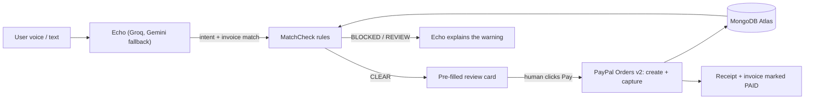

# SayPay — Say it. Check it. Pay with confidence.

> A voice-first payment companion. **Echo**, our AI assistant, understands what you want to pay, deterministic **MatchCheck** safety rules verify it against the real invoice, and **you** approve the PayPal payment with one click.

Built for the **PayPal AI Developer Hackathon** · MIT licensed · Next.js + PayPal Sandbox + Groq/Gemini

---

## The problem

Paying a bill is easy. Paying the **right** bill is not. Fake invoices, changed amounts, look-alike merchants, and accidental double payments all look the same as a real bill until the money is gone. AI agents that pay for you on their own make this risk worse, not better.

## Our answer

SayPay splits the job into three parts so no single part can move money alone:

| Who | Does what | Can it move money? |
|---|---|---|
| **Echo (AI)** | Listens, understands intent, finds the invoice, explains results out loud | No |
| **MatchCheck (rules)** | Compares what you *said* with what the invoice *says*: recipient, amount, currency, reference, duplicates, merchant status | No — it can only block |
| **You (human)** | Review the pre-filled PayPal card and click **Pay with PayPal** | **Yes — only you** |

**AI talks. Rules decide. Humans approve.**

---

## Features

**Buyer**
- Talk or type to Echo: *"Is the TechNova invoice paid?"*, *"What's due this week?"*, *"Pay GreenLeaf"*.
- Hands-free voice: mic stays on, sends automatically when you pause, stops when you say *"bye"*, *"stop"* or *"that's all"*. Mute button included.
- Automatic 4-stage flow: **Capture → Safety check → Review & confirm → Receipt**.
- Echo reads the safety verdict aloud. The mic switches off at the payment step, so payment always needs a human click.
- PayPal Sandbox order creation + capture; invoice is marked **PAID** in MongoDB and leaves the unpaid list.

**Merchant**
- Voice invoicing: *"Create invoice for buyer@saypay.app for 3 coffee bags at $45"*.
- Merchant flow stages: **Capture → Validation → Review & Issue → Dispatched**.

**Platform**
- Separate buyer / merchant logins with role-based dashboards and protected routes.
- Transaction history on AG Grid with search, status filters and CSV export, loaded from real database records.

---

## MatchCheck safety rules

Every payment goes through deterministic checks before PayPal is called. Each check returns a reason code:

| Reason code | Meaning | Result |
|---|---|---|
| `RECIPIENT_MISMATCH` | Payee differs from what you asked for | Blocked |
| `AMOUNT_MISMATCH` | Amount differs from the invoice | Blocked |
| `CURRENCY_MISMATCH` | Currency differs | Blocked |
| `REFERENCE_MISMATCH` | Invoice reference differs | Review |
| `DUPLICATE_PAYMENT` | This invoice was already settled | Blocked |
| `UNKNOWN_MERCHANT` / `INACTIVE_MERCHANT` | Payee isn't a known, active merchant | Blocked |
| `AMOUNT_EXCEEDS_LIMIT` | Above the safety limit | Review |
| `NEEDS_CLARIFICATION` | Intent too vague to match | Ask the user |

Only a **CLEAR** verdict enables the PayPal button (`canCreateOrder: true`).

---

## Integrations

### PayPal (REST API, Sandbox) — `src/lib/paypal.js`
| # | Endpoint | Used for |
|---|---|---|
| 1 | `POST /v1/oauth2/token` | Server-side access token (client credentials) |
| 2 | `POST /v2/checkout/orders` | Create an order from a CLEAR MatchCheck (amount, currency, invoice reference) |
| 3 | `POST /v2/checkout/orders/{id}/capture` | Capture after the human clicks Pay |
| 4 | `GET /v2/checkout/orders/{id}` | Read back order status for verification |

Base URL: `https://api-m.sandbox.paypal.com`. Requests use idempotency keys, and transactions move through explicit states (`CREATED → CAPTURE_PENDING → COMPLETED`), so a repeated capture returns the stored result instead of charging twice.

### AI
| Service | Role |
|---|---|
| **Groq** (`openai/gpt-oss-120b`, OpenAI-compatible chat API) | Main brain for Echo: intent, invoice queries, natural replies, structured JSON actions |
| **Google Gemini** | Fallback for intent / payment-request extraction and plain-language explanations |
| **Web Speech API** (browser) | Speech-to-text (continuous recognition) and soft text-to-speech |
| Heuristic parser | Offline fallback so Echo still works if both AI providers are rate-limited |

### Data
**MongoDB Atlas** (Mongoose): `users`, `invoices`, `paymentchecks`, `transactions`.

---

## Architecture



### Key API routes
| Route | Purpose |
|---|---|
| `POST /api/assistant` | Echo conversation, intent, invoice queries, prepares a PaymentCheck |
| `POST /api/payment/check` | Run MatchCheck on intent + request |
| `POST /api/paypal/create-order` | Create a PayPal order for a CLEAR check |
| `POST /api/paypal/capture-order` | Capture, record transaction, mark invoice PAID |
| `GET /api/invoices`, `GET /api/transactions` | Live data for lists, dashboard and history |
| `POST /api/auth/login`, `/logout`, `GET /api/auth/me` | Signed cookie session, buyer / merchant roles |

---

## Run it locally

```bash
git clone https://github.com/ronBusiness-git/saypay.git
cd saypay
npm install
cp .env.example .env.local   # or create it with the keys below
node scripts/seed-demo-data.js   # demo users, merchants, invoices
npm run dev                  # http://localhost:3000
```

`.env.local`
```
MONGODB_URI=mongodb+srv://...
PAYPAL_CLIENT_ID=your_sandbox_client_id
PAYPAL_CLIENT_SECRET=your_sandbox_secret
PAYPAL_BASE_URL=https://api-m.sandbox.paypal.com
GROQ_API_KEY=...
GEMINI_API_KEY=...            # optional fallback
SESSION_SECRET=any-long-random-string
```

Demo accounts (password `saypay123`): **buyer@saypay.app** (buyer) · **seller@saypay.app** (merchant).

Voice works best in **Chrome** (Web Speech API). Allow microphone access when asked.

### Tests
```bash
npm run build
npx playwright test tests/echo-conversational-gateway.spec.js
```

---

## Tech stack
Next.js 16 (App Router, plain JavaScript) · React · Tailwind CSS · AG Grid · MongoDB Atlas / Mongoose · PayPal REST (Orders v2) · Groq · Google Gemini · Web Speech API · Playwright

## Known limitations
- Sandbox only. No real money moves.
- Capture runs server-side right after the human clicks Pay; a production version would add the PayPal buyer-approval redirect / JS SDK button.
- Voice recognition quality depends on the browser (best in Chrome).

## Team
Built by Ronald, Subash and Rabin for our first hackathon.

## License
[MIT](LICENSE)
